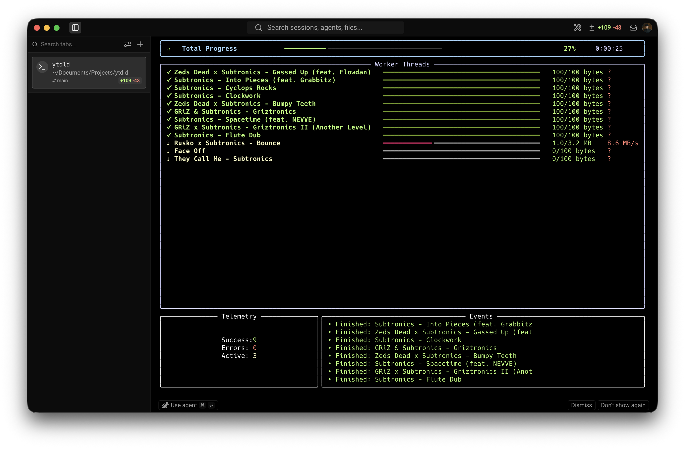

<div align="center">

# ytdld

### An interactive terminal app for downloading YouTube as **MP3 · MP4 · FLAC**

Paste your links, flip a few switches, watch every track stream in parallel — all without leaving the terminal.

[](https://github.com/himudigonda/ytdld/actions/workflows/ci.yml)
[](https://www.python.org/)
[](https://github.com/Textualize/textual)
[](https://github.com/yt-dlp/yt-dlp)
[](LICENSE)
[]()
[]()

</div>

---

## ⚡ TL;DR

```bash
# install
curl -fsSL https://raw.githubusercontent.com/himudigonda/ytdld/main/install.sh | bash

# run — that's it, the TUI opens
ytdld
```

No flags to memorize. `ytdld` launches a full-screen interactive app: paste links on the left, set format/quality/threads/SponsorBlock/etc. as on-screen controls on the right, and hit **Download**. Prefer scripting? The classic `ytdld -i links.txt --mode mp4` fast-path is still there.

---

## ✨ Highlights

- 🖥️ **TUI-first.** Bare `ytdld` opens an interactive app — paste, configure, download, all on screen.
- 🎧 **Three formats.** `mp3` (audio), `mp4` (video), `flac` (lossless) — each with embedded metadata + cover art.
- 🎚️ **Quality control.** Cap MP4 at 1080p / 720p / 480p so a tutorial isn't a 4 GB download.
- ⏩ **Parallel downloads.** Up to 8 workers with a live per-track dashboard.
- ⛔ **SponsorBlock built in.** Mark or auto-skip sponsor / intro / outro segments.
- 🔁 **Idempotent.** A download archive skips anything you've already grabbed.
- 🍪 **Cookies from your browser.** Unlock age-gated content without manual cookie files.
- 🧹 **Forgiving input.** Paste messy URLs, playlists, `youtu.be`, Shorts — IDs are parsed, de-duped, and resolved to real titles.
- 🔁 **Resilient.** Automatic network retries, abortable downloads, and one-key retry of failed tracks.
- ⚙️ **Config that sticks.** Your TUI choices persist to `~/.config/ytdld/config.toml` and become the defaults.
- 🔔 **Desktop notification** when a batch finishes.
- 🩺 **Batteries included.** `ytdld doctor`, `ytdld update`, `ytdld config`, shell completions.

---

## Table of contents

- [Install](#install)
- [The TUI](#the-tui)
- [Commands](#commands)
- [Formats & quality](#formats--quality)
- [Features in depth](#features-in-depth)
- [Configuration](#configuration)
- [Headless / scripting](#headless--scripting)
- [Shell completions](#shell-completions)
- [Output layout](#output-layout)
- [Safety & legal](#safety--legal)
- [Responsible use](#responsible-use)
- [Troubleshooting](#troubleshooting)
- [Uninstall](#uninstall)
- [Contributing](#contributing)
- [License](#license)

---

## Install

### Prerequisites

| Requirement | Why | Install |
|-------------|-----|---------|
| **Python 3.11+** | runtime | `brew install python@3.11` |
| **ffmpeg** | audio conversion, video merge, thumbnails | `brew install ffmpeg` · `sudo apt install ffmpeg` · `sudo pacman -S ffmpeg` |
| **uv** | manages ytdld's environment | installed automatically by the script |

> Run `ytdld doctor` any time to verify your environment is healthy.

### One-liner

```bash
curl -fsSL https://raw.githubusercontent.com/himudigonda/ytdld/main/install.sh | bash
```

### Or with uv directly

```bash
uv tool install "ytdld @ git+https://github.com/himudigonda/ytdld"
```

If your shell can't find `ytdld` afterward, add uv's bin dir to your PATH:

```bash
export PATH="$HOME/.local/bin:$PATH"   # add to ~/.zshrc or ~/.bashrc
```

Verify:

```bash
ytdld --version
ytdld doctor
```

---

## The TUI

Just run:

```bash
ytdld
```

### 1 · Compose screen

Paste links on the left; every option is a live control on the right.

```
┌─ ytdld v3.0.0 ────────────────────────────────────────────────────────────┐
│ Paste YouTube links (any format)            │  Output folder                │
│ ┌─────────────────────────────────────────┐ │  ~/Music/Downloads            │
│ │ https://youtu.be/dQw4w9WgXcQ            │ │  Format     [ MP3  (audio) ▾] │
│ │ https://youtube.com/playlist?list=PL... │ │  Quality    [ best         ▾] │
│ │ https://youtube.com/shorts/abcdefghijk  │ │  Threads    [ 3            ▾] │
│ │                                         │ │  SponsorBlk [ skip segments▾] │
│ └─────────────────────────────────────────┘ │  Cookies    [ none         ▾] │
│ [path/to/links.txt] [Load file][Paste][Clear]│  ◉ Skip already-downloaded    │
│                                              │  ◉ Embed thumbnail / cover    │
│                                              │  ◉ Embed metadata             │
│                                              │  ◉ Notify when finished       │
├──────────────────────────────────────────────────────────────────────────┤
│            [ ⬇ Download all ]   [ ☑ Resolve & pick ]   [ Quit ]             │
└──────────────────────────────────────────────────────────────────────────┘
```

- **Load file** — type a path and pull a links file into the editor.
- **Paste clipboard** — append whatever's on your clipboard.
- **⬇ Download all** (`Ctrl+D`) — resolve playlists and start immediately.
- **☑ Resolve & pick** (`Ctrl+R`) — open the selection screen first.

The **Quality** control is enabled only for MP4. Your settings are saved as defaults the moment you start a download.

### 2 · Select screen (optional)

A checkbox list of every resolved track — all pre-checked. `Space` toggles, `a` selects all, `n` selects none, `Ctrl+D` downloads the checked ones. Perfect for pasting a 200-track playlist and grabbing only what you want.

### 3 · Progress screen

A live dashboard while downloading:

- a **total** progress bar with ETA,
- a **per-track table** (status · title · progress bar · speed) that updates in real time,
- a **stats line** (✓ done · ✗ errors · ⇣ active),
- a scrolling **event log**.

When it finishes: press `q` to quit, `o` to open the output folder, or `r` to **retry just the failed tracks**. Quitting mid-download cleanly aborts in-flight transfers. Network hiccups are retried automatically (yt-dlp retries built in).

> The screenshot below shows the live download dashboard.
>
> 

---

## Commands

ytdld keeps its verbs few — features live *inside* the TUI, not as a flag for each one.

| Command | What it does |
|---------|--------------|
| `ytdld` | Launch the interactive TUI (default) |
| `ytdld tui` | Same, explicitly |
| `ytdld doctor` | Check your environment: Python, ffmpeg, yt-dlp, config, PATH |
| `ytdld update` | Self-update via uv (pulls a fresh yt-dlp too) |
| `ytdld config` | Show config · `--edit` to open in `$EDITOR` · `--reset` to restore defaults · `--path` |
| `ytdld completions <shell>` | Print a `bash` / `zsh` / `fish` completion script |
| `ytdld --version` | Print version |
| `ytdld -i links.txt …` | Headless download fast-path (see [Headless](#headless--scripting)) |

---

## Formats & quality

| Mode | Output | Notes |
|------|--------|-------|
| **mp3** | audio | VBR 0 (~320 kbps), cover art + ID3 tags. The default. |
| **mp4** | video | best video + audio merged; respects the **Quality** cap |
| **flac** | audio | lossless, for archival / audiophile libraries |

**MP4 quality** caps the height: `best`, `2160p`, `1440p`, `1080p`, `720p`, `480p`.

> 💾 A 3-minute song is ~5–10 MB as MP3. The same as 1080p MP4 is ~150–400 MB. Use the quality cap.

---

## Features in depth

**SponsorBlock** — `off`, `mark` (adds chapters at sponsor/intro/outro segments), or `skip` (cuts them out of the file). Uses the community [SponsorBlock](https://sponsor.ajay.app/) database via yt-dlp.

**Download archive** — when *Skip already-downloaded* is on, every completed video id is recorded in `~/.config/ytdld/archive.txt`. Re-run the same playlist tomorrow and only new uploads download. Makes ytdld safe to run on a repeating schedule.

**Cookies from browser** — pick `chrome` / `firefox` / `brave` / `edge` / `safari` / etc. to reuse your logged-in session for age-gated or members-only content. Nothing is stored by ytdld; it reads the browser's cookie store at download time.

**Embed thumbnail & metadata** — both on by default; toggle off if you want bare files.

**Notification** — a native macOS / Linux notification fires when the batch completes.

---

## Configuration

Everything you set in the TUI persists to:

```
~/.config/ytdld/config.toml      # honors $XDG_CONFIG_HOME
```

These values become the defaults for both the TUI controls and the headless flags.

```bash
ytdld config            # print current settings + path
ytdld config --edit     # open in $EDITOR
ytdld config --reset    # restore defaults
ytdld config --path     # print just the path
```

```toml
# ~/.config/ytdld/config.toml
out_dir = "~/Music/Downloads"
mode = "mp3"
quality = "best"
threads = 3
archive = false
cookies_from_browser = ""
sponsorblock = "off"
embed_thumbnail = true
embed_metadata = true
notify = true
```

---

## Headless / scripting

For cron jobs, pipelines, and muscle memory, the flag interface is intact. Any time the first argument isn't a known command, ytdld runs headless with plain, CI-friendly output. **Defaults come from your config file.**

```bash
ytdld -i links.txt                          # MP3, using your saved defaults
ytdld -i links.txt --mode mp4 --quality 720p
ytdld -i links.txt --mode flac --threads 4
ytdld -i links.txt --archive                # skip what you already have
ytdld -i links.txt --sponsorblock skip
ytdld -i links.txt --cookies-from-browser firefox
ytdld -i links.txt --dry-run                # list resolved tracks, download nothing
ytdld -i links.txt --select                 # interactive checkbox picker
```

| Flag | Default | Description |
|------|---------|-------------|
| `-i, --input PATH` | required | text file of YouTube URLs |
| `-o, --out DIR` | config | output directory |
| `--mode {mp3,mp4,flac}` | config | output format |
| `--quality {best,2160p,1440p,1080p,720p,480p}` | config | MP4 height cap |
| `--threads N` | config | parallel workers |
| `--archive` | config | skip already-downloaded items |
| `--cookies-from-browser NAME` | config | reuse browser cookies |
| `--sponsorblock {off,mark,skip}` | config | SponsorBlock handling |
| `--no-thumbnail` | — | don't embed cover art |
| `--no-metadata` | — | don't embed metadata |
| `--select` | off | interactive picker before downloading |
| `--dry-run` | off | resolve & list without downloading |
| `--no-notify` | — | suppress completion notification |

The input file is forgiving: paste raw URLs in any format (videos, playlists, `youtu.be`, Shorts, even url-encoded copy-paste). IDs are extracted and de-duplicated; non-YouTube lines are ignored.

---

## Shell completions

```bash
# bash — add to ~/.bashrc
eval "$(ytdld completions bash)"

# zsh — add to ~/.zshrc
eval "$(ytdld completions zsh)"

# fish
ytdld completions fish | source
```

---

## Output layout

Files are organized by uploader:

```
~/Music/Downloads/
  Martin Garrix/
    Animals.mp3
    Tremor.mp3
  Hardwell/
    Spaceman.mp3
```

For `mp4`:

```
~/Music/Downloads/
  Veritasium/
    The Most Misunderstood Concept in Physics.mp4
```

Filenames are sanitized for cross-platform safety (Windows-invalid characters are replaced).

---

## Safety & legal

**Please read before using.**

- **Personal use only.** ytdld is for downloading content for your own offline use. It is not for redistribution, commercial use, or anything that infringes creators' rights.
- **Copyright.** Downloading does not transfer any rights. Don't re-upload, sell, distribute, or reuse downloaded content without proper licensing.
- **YouTube's Terms.** Automated downloading is [against YouTube's ToS](https://www.youtube.com/t/terms) (§5.B). You use this software at your own risk; excessive traffic can get your IP rate-limited.
- **What can't be bypassed:** DRM-protected content, private videos, and (without cookies) age-restricted or members-only videos. Geo-restricted videos fail unless accessible from your region.
- **Support creators.** If you enjoy someone's work, support them — YouTube Premium shares revenue with creators.

---

## Responsible use

| Situation | Threads |
|-----------|---------|
| A few tracks | `3` (default) |
| Large playlist (100+) | `4–5` |
| Multiple full playlists | `3`, be patient |
| Ever | avoid `8`+ — you'll get rate-limited |

If you hit `HTTP Error 429` / `Too Many Requests`, stop, wait 15–30 minutes, and retry with fewer threads. Each worker uses ~1–10 MB/s — mind metered connections, especially for MP4.

---

## Troubleshooting

Run **`ytdld doctor`** first — it checks most of these automatically.

| Symptom | Fix |
|---------|-----|
| `ytdld: command not found` | Add `export PATH="$HOME/.local/bin:$PATH"` to your shell config, then reload. |
| MP3/MP4 fails or no cover art | Install **ffmpeg** (see [Install](#install)); confirm with `which ffmpeg`. |
| `Sign in to confirm you're not a bot` | Wait 10–30 min, lower threads, or set **Cookies from browser**. |
| `Private video` / `not available` | Private/deleted/geo-restricted — ytdld skips it and continues. |
| Age-restricted video fails | Set **Cookies from browser** to the browser where you're logged in. |
| TUI looks cramped | Resize your terminal larger; the layout is responsive but wants some width. |
| `uv tool install` fails | `uv self update`, then retry. Check internet access. |

---

## Uninstall

```bash
curl -fsSL https://raw.githubusercontent.com/himudigonda/ytdld/main/uninstall.sh | bash
# or
uv tool uninstall ytdld
```

Your downloaded files are never touched. To remove uv too: `uv self uninstall`.

---

## Contributing

```bash
git clone https://github.com/himudigonda/ytdld
cd ytdld
uv sync --dev
uv run pytest          # run the test suite
uv run ytdld           # run the TUI from source
```

CI runs the test suite + a build on Python 3.11–3.13. PRs welcome.

---

## License

[MIT](LICENSE) © Himansh Mudigonda

Built on [yt-dlp](https://github.com/yt-dlp/yt-dlp), [Textual](https://github.com/Textualize/textual), [rich](https://github.com/Textualize/rich), and [questionary](https://github.com/tmbo/questionary). SponsorBlock data from the [SponsorBlock project](https://sponsor.ajay.app/).
